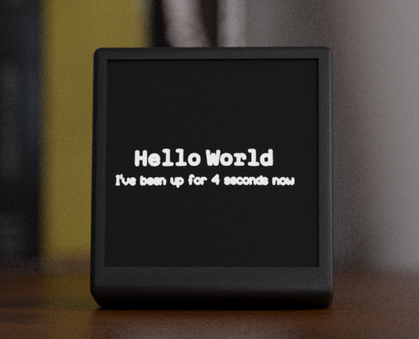
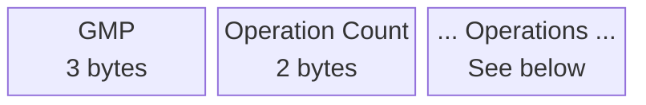
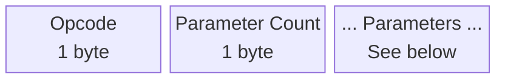
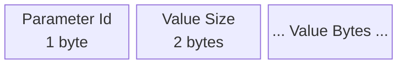

  


This is a custom firmware for the GeekMagic Display (ESP12F model) that lets you render content remotely. Rendering instructions can be manually written out or it can be sent via a custom React renderer. This let you write a quick, component based UI for the display, (almost) as if you were writing, complete with Reacts state management and hooks.

Rendering instructions are sent over a websocket connection to the display. Rendering instructions are described by the renderer, and the content is layouted to web standard (mostly) with the help of [Yoga Layout](https://www.yogalayout.dev) and state is fully managed by React. You can also hook up external inputs such as push buttons or capacitive touch sensors and use those within your components!

---

## Installation
Right now you can just build it via [PlatformIO](https://platformio.org/install/ide?install=vscode) and send it over the ESP12F via a [CH343 board](https://www.waveshare.com/wiki/CH343_USB_UART_Board). You can get these for pretty cheap on Aliexpress. I'll work on an easier way to upload the firmware in the future

## Usage
```tsx
import CreateRenderer from "@geekmagic-react/create-renderer.js";
import { Box, Text, TtfText } from "@geekmagic-react/elements.js";
import { config } from "dotenv";
import { useEffect, useState } from "react";

function App() {
	const [seconds, setSeconds] = useState(0);
	useEffect(() => {
		const interval = setInterval(() => {
			setSeconds((prev) => prev + 1);
		}, 1000);
		return () => clearInterval(interval);
	}, []);

	return (
		<Box tb="p-[20] flex items-center justify-center h-full gap-[5]">
			<TtfText
				fontPath={"example_assets/raw_fonts/MartianMono.ttf"}
				fontSize={20}
			>
				Hello World
			</TtfText>
			<Text>I've been up for {seconds} seconds now</Text>
		</Box>
	);
}

config();

const [_, render] = await CreateRenderer({
	host: process.env.DISPLAY_ADDRESS as string,
	port: 81,
});

render(<App />);
```


## Websocket Protocol (GMRRP)
GMRRP stands for `Geekmagic Remote Render Protocol`. It's not the best design but it gets the job done. Each rendering instruction packet can store 65535 operations. Each operation can have 255 parameters and each parameter can have a max value size of 65535 bytes.

### Packet format
This is the first level of the packet. It just has a header, and operation count. Followed by a series of the Operation Structure
| Field      | Description |
|------------|-------------|
| GMP        | Magic header identifying the protocol |
| Count      | Number of operations (16-bit unsigned integer, little-endian) |
| Operations | Concatenated binary operation records. Can support 65535 operations |



### Operation Structure
This is the operation structure. It has an opcode, parameter count and finally followed by a series of the parameter structure. See the declaration file to see a list of available operations
| Field           | Description |
|-----------------|-------------|
| Opcode          | Identifies the operation |
| Parameter Count | Number of parameters in the operation (8-bit unsigned integer, little-endian) |
| Parameters      | Operation parameters. Can support 255 parameters |




### Parameter Structure
This is the parameter structure. It has a parameter Id, value size and value bytes. If a parameter ID that is not required for a operation is sent, that parameter will just be ignored. See the declaration to see a list of available parameters
| Field           | Description |
|-----------------|-------------|
| Parameter Id    | Identifies the parameter |
| Value Size      | Size of the value in bytes (8-bit unsigned integer, little-endian) |
| Value Bytes      | Actual Value Bytes. Can support 65535 bytes |


